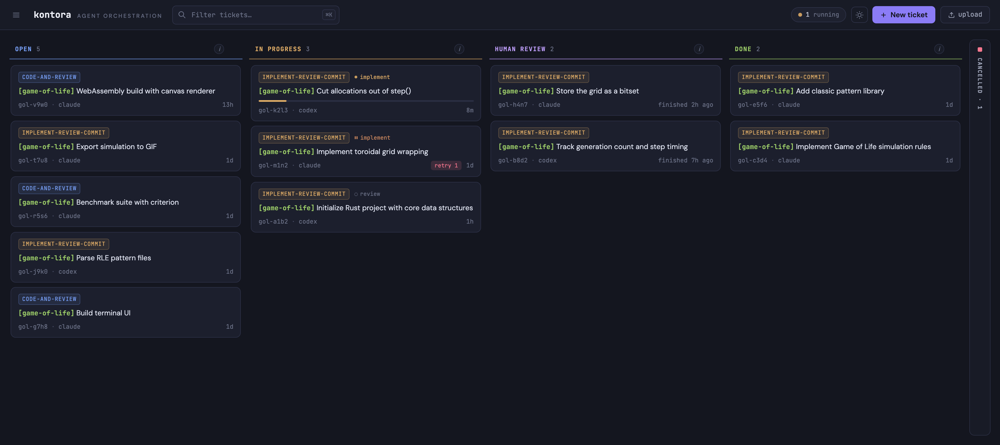
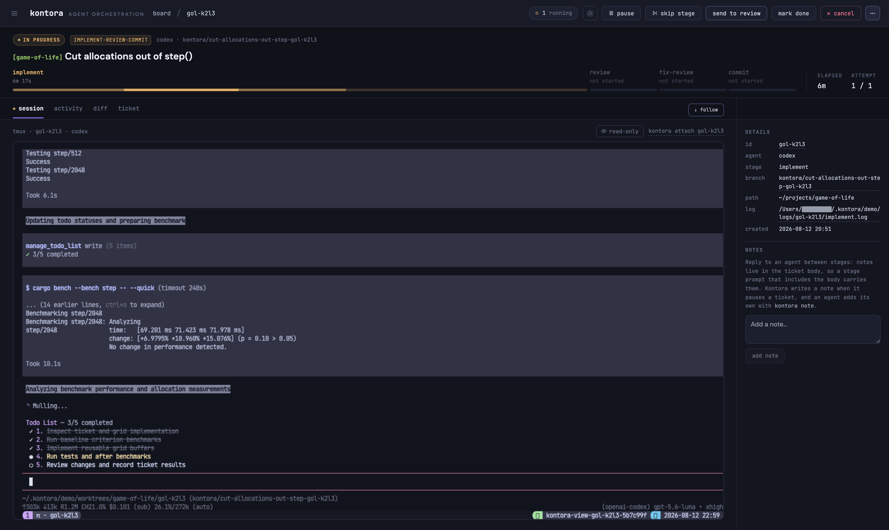

# Kontora

[](https://github.com/worksonmyai/kontora/actions/workflows/ci.yml)
[](https://goreportcard.com/report/github.com/worksonmyai/kontora)

Kontora runs AI coding agents on tasks you write as Markdown tickets. You can queue work across repositories, watch agents in a web or terminal board, and review their changes.

Each ticket gets a branch and a separate checkout, called a Git worktree. Use one agent run per ticket, or a pipeline that implements, reviews, and fixes code in separate steps.

<picture>
  <source media="(prefers-color-scheme: dark)" srcset="docs/dark.png">
  <source media="(prefers-color-scheme: light)" srcset="docs/light.png">
  
</picture>

<details>
<summary>Live agent terminal</summary>
<br>

</details>

## Install

You need macOS or Linux, Git, tmux, and an installed coding agent such as Claude Code, Pi, or OpenCode. Sign in to your agent before using it with Kontora.

With Homebrew:

```bash
brew tap worksonmyai/kontora https://github.com/worksonmyai/kontora
brew install kontora
```

Or build from source with Go 1.27.4 or newer:

```bash
git clone https://github.com/worksonmyai/kontora.git
cd kontora
make install
```

To ask a coding agent for help:

> Help me install and set up Kontora: https://raw.githubusercontent.com/worksonmyai/kontora/main/llms.txt

## Run your first ticket

Create a config and check your tools:

```bash
kontora setup
kontora doctor
```

Choose the `default` pipeline for your first run. It asks the agent to implement and test, then waits in `human_review`. The optional `implement-review-commit` pipeline also commits before waiting for you. Neither starter pipeline asks the agent to push.

The wizard normally writes `~/.config/kontora/config.yaml`. It does not overwrite an existing config. For agent-assisted configuration, use `kontora setup --agent`; it prints instructions without writing anything.

> [!WARNING]
> The wizard's Claude arguments include `--dangerously-skip-permissions`. Worktrees separate checkouts, but do not restrict an agent's filesystem or network access. Use agent permissions or an external sandbox appropriate for your repositories.

Start the daemon, which runs tickets and serves the board. Keep this terminal open until you stop it with Ctrl-C:

```bash
kontora start
```

In another terminal, create a draft in your repository:

```bash
cd ~/projects/myrepo
kontora new --status open "Add a health check endpoint"
```

The command prints a ticket ID. Replace `TICKET_ID` below with that ID:

```bash
kontora edit TICKET_ID
kontora run TICKET_ID
```

Add the requirements and expected tests before running. Without `--status open`, `kontora new` creates a queued ticket that a running daemon can pick up immediately.

Open http://127.0.0.1:8080 or run `kontora` for the terminal board. When the ticket reaches `human_review`, inspect its changes before closing it. Kontora does not automatically merge the ticket's branch.

See [Getting started](docs/getting-started.md) for monitoring, review, retries, and configuration choices.

## Next steps

- [Configuration](docs/configuration.md): choose agents, pipelines, and per-repository defaults.
- [CLI reference](docs/cli.md): create, run, inspect, and manage tickets.
- [Tickets](docs/tickets.md): dependencies, epics, schedules, and file format.
- [Automations](docs/automations.md): recurring agent tasks without tickets.
- [Remote access](docs/remote.md): use a daemon on another machine.
- [API reference](docs/api.md): integrate with the board or inspect [cost estimates](docs/api.md#cost-estimates).
- [Changelog](CHANGELOG.md): release history.

Tickets are Markdown files with YAML frontmatter, inspired by [wedow/ticket](https://github.com/wedow/ticket). No database is required.
